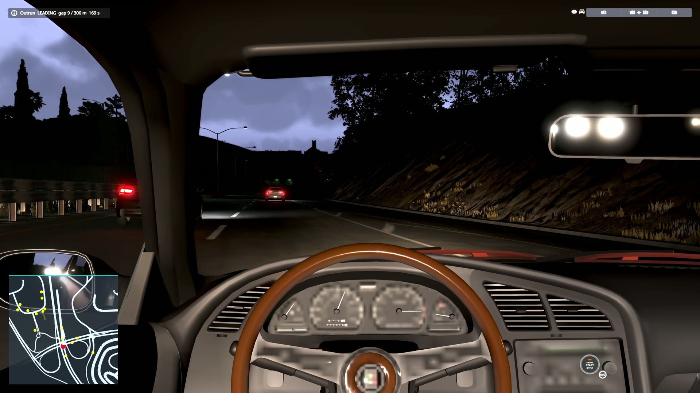
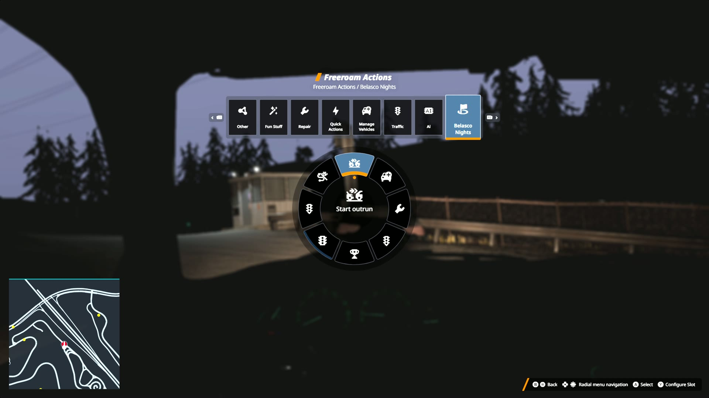
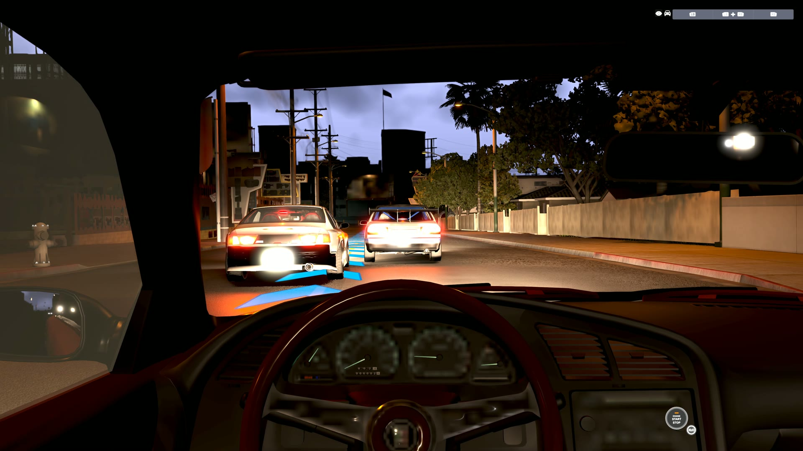
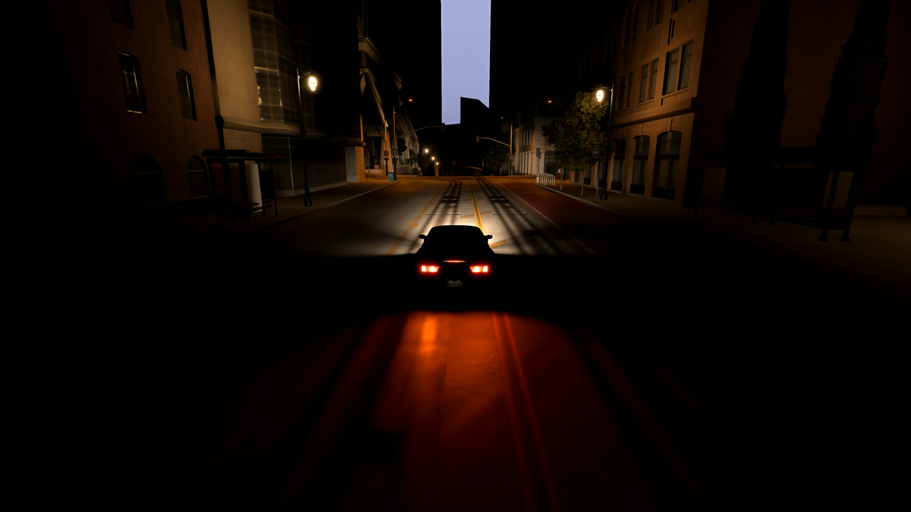
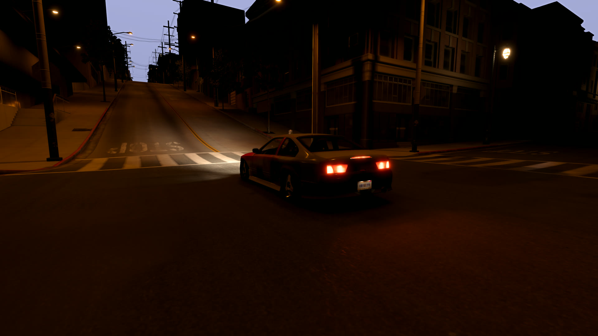

# Belasco Nights

A fan tribute to Need for Speed Underground 2 for BeamNG.drive. The streets open at night: outruns, sprint races, a parts garage, cash and rep.

Unofficial fan project. Not affiliated with or endorsed by EA or BeamNG.

## Features

- **Night mode** from the radial menu: the clock goes to midnight and the night is brightened so you can see the road. Brightness cycles off / low / medium / high.
- **Outrun**: a rival spawns ahead of you. Whoever is in front wins by getting 300 m clear. 4-minute limit.
- **Sprint**: a 1.5-4 km point-to-point route is generated from wherever you are parked, against three rivals, with checkpoints and route arrows.
- **Rivals matched to your car**: picked by your car's stock power, getting stronger as your rep rises (tiers at 500 and 2,000 rep). They launch on GO with their headlights on.
- **Garage**: at any garage on the map, buy parts with your winnings at the game's own part values, with part exchange on what you take off. Runs from the radial menu, so it works on a controller.
- **Minimap** in the bottom-left corner: nearby roads, traffic (yellow), rivals (red) and the next sprint checkpoint.
- **Cash, rep and a short story** that unlocks as your rep rises.
- **Music**: put `.ogg` files in `belascoNights/music/` inside the mod and they play while the streets are open. No music is included.

| | |
|---|---|
|  |  |
|  |  |

## Install

Download `belasco_nights.zip` from the [latest release](../../releases/latest) and copy it into your BeamNG `mods` folder. Do not unzip it.

## How to play

1. Load a map in Freeroam and get in a car.
2. Open the radial menu, Sandbox section, **Belasco Nights**.
3. Pick **Night mode on**.
4. Park on a road and pick **Start outrun** or **Start sprint race**.
5. Drive to any garage and pick **Garage** to spend your winnings. Away from a garage, the same entry sets a route to the nearest one.

Keys can also be bound under Options > Controls: search for "Belasco Nights".

## RLS Career Overhaul

Belasco Nights runs alongside [RLS Career Overhaul](https://www.beamng.com/threads/rls-career-overhaul.99819/) (built against 2.7.0) but does not need it.

- In a career save, race winnings are paid into your career wallet.
- In career the streets open by themselves when the career clock reaches night; there is no manual switch.
- Rep is tracked by Belasco Nights in both freeroam and career.
- The Belasco Nights garage and starter car are freeroam only.

## Not in this version

Drag, drift and circuit events, visual customisation shops and sponsors from the original game.

## Known limits

- Built and tested on BeamNG.drive 0.39.4, West Coast USA only. Other maps should work if they have a road network and garages, but are untried.
- Sprint routes and garage purchases have had little testing.
- Rival matching uses the stock power of your car's configuration, so parts fitted afterwards are not counted.
- This release has only been run as an unpacked mod; the zip itself has not been load-tested.

Settings are in `belascoNights/config.json`.

## Building the zip

`python3 build.py` writes `belasco_nights.zip` containing only the mod files.

## How it was made

Written in one day with Claude Code, which also drove the running game to test and record it.

## Licence

MIT. See [LICENSE](LICENSE).
